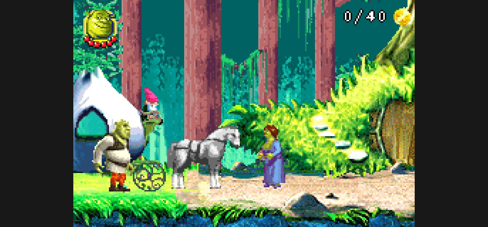
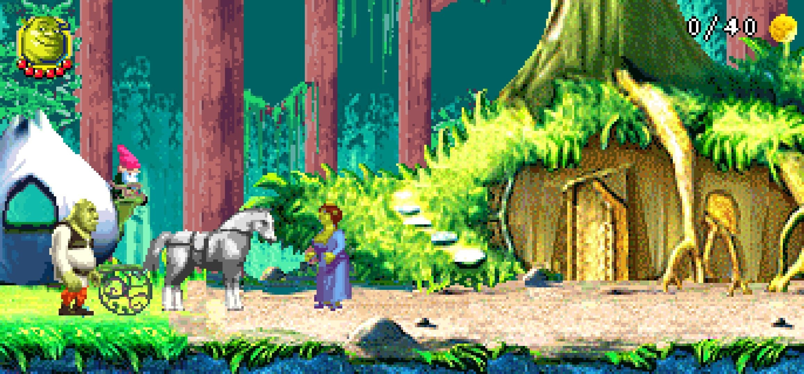
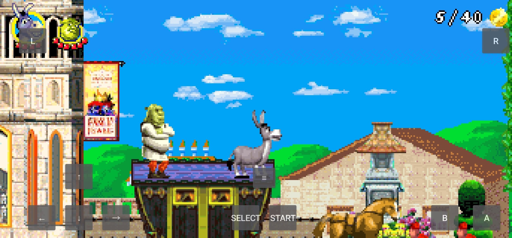

<p align="center">
  
</p>

<h1 align="center">Project Far Far Away</h1>

<p align="center">
  An AI-assisted native Android port of Shrek 2 (GBA)
</p>


[GitHub](https://github.com/Yusuff1406/Project-Far-Far-Away) · [GNU GPL v3.0](LICENSE)

An unofficial, AI-assisted native Android port and reverse-engineering project for **Shrek 2 (Game Boy Advance)**. The Android app uses Java and a C++ runtime through JNI. This is an ongoing reconstruction, not a claim of a complete matching decompilation.

Development uses substantial AI assistance, including OpenAI Codex, with iterative gameplay comparisons and maintainer feedback. See [audit scope and results](docs/AUDIT.md).
## Features

### Native Android Experience
- **Native Android Port** — A native reimplementation of Shrek 2 (GBA) without traditional GBA emulation.
- **Widescreen Support** — Full widescreen support for the main levels. Widescreen support for minigames and boss fights is currently experimental and may be unstable.
- **High Refresh Rate Support** — Supports refresh rates of up to **240 Hz**.
- **External Controller Support** — Compatible with third-party gamepads.
- **Touchscreen Controls** — On-screen controls optimized for Android devices.

### Level Editor & Customization
- **Full-Featured Level Editor** — Tools for editing and customizing game levels.
- **Character Customization** — Modify character attributes and gameplay parameters.
- **Character Switching** — Switch between playable characters during a level.
- **Gameplay Modifiers** — Freeze timers, freeze enemies, enable invincibility, and adjust other gameplay settings.

### Saves & Gameplay
- **Save Support** — Save and continue your progress.
- **Game Speed Control** — Increase gameplay speed up to **4×**.
- **Instant Level Unlocking** — Unlock all levels without completing the campaign.
- **Puss in Boots Double Jump** — An optional quality-of-life gameplay enhancement.

### Audio & Quality-of-Life Improvements
- **Independent Audio Controls** — Enable or disable music and sound effects separately.
- **Custom Level Music** — Use music from other levels, including **two unused soundtracks** from the original game.
- **Additional Quality-of-Life Features** — Various gameplay improvements, customization options, and convenience features.

### Development & Open Source
- **AI-Assisted Development** — Reverse engineering, native engine development, debugging, and testing assisted by artificial intelligence.
- **Open-Source Project** — Released under GPL-3.0 to encourage community contributions and further development.

> **Note:** Project Far Far Away is still under active development. Some features may be incomplete or unstable, particularly experimental widescreen support for minigames and boss fights.
> 
<h2> Screenshots</h2>

<h3>Original vs. Widescreen</h3>

<p>
  Comparison between the original game viewport and
  the expanded widescreen rendering mode.
</p>

<table>
  <tr>
    <th align="center">Original View</th>
    <th align="center">Widescreen Mode</th>
  </tr>
  <tr>
    <td width="50%">
      
    </td>
    <td width="50%">
      
    </td>
  </tr>
</table>

<h3>Android Gameplay</h3>

<p align="center">
  
</p>

## Source-only distribution

This public archive contains code, extraction tools and build instructions. It contains **no ROM, original game media or decoded game-resource packages**. The FF app icon is an original vector placeholder. The gameplay code remains based on Stage110.

Before building the APK or running game-dependent tests, generate resources locally from your own matching original ROM. The tool does not download a ROM or bundle one into the APK. The Android application also retains its original-ROM import check.

Expected ROM: **Shrek 2 (USA, Europe)**. SHA-256:

```text
2ec32cb8c69ff8bbe01b7039ee001105f92ee686b251d26060f9bdb6751f3b80
```

## Build

The tested direct build route uses **Linux x86-64, Python 3.12, JDK 17, Android SDK platform 35, Build Tools 35.0.0, NDK 28.0.13004108 and CMake 3.22.1**. Output: ARM64, Android 8.0 / API 26 or newer.

```bash
python3 -m venv .venv
source .venv/bin/activate
python3 -m pip install -r requirements-audit.txt
python3 tools/prepare_assets.py /absolute/path/to/original.gba --jobs 2
python3 tools/build_android_debug.py --sdk /absolute/path/to/android-sdk --jdk /absolute/path/to/jdk-17 --output dist/ProjectFarFarAway-debug.apk
```

Resource preparation verifies the ROM before writing output and compares all **357** runtime resources against the audited Stage110 checksums. It can take several minutes because it renders audio locally. `--skip-audio` is only for data-extraction work; an incomplete resource set cannot pass the APK build preflight.

Read [BUILD.md](docs/BUILD.md) for installation, tests and signing details. The repository does not bundle SDK/JDK binaries or a Gradle wrapper. A locally generated debug key will differ from previously distributed APKs unless you privately reuse their signing key; back up app data before replacing an installation.

## Checks

Without a ROM:

```bash
python3 tests/verify_source_only.py
bash native/build.sh
```

After resource preparation:

```bash
python3 tests/verify_stage105.py
python3 tests/verify_stage109.py
python3 tests/verify_stage110.py
python3 tests/verify_unified_activity75.py --jdk /absolute/path/to/jdk-17 --rom /absolute/path/to/original.gba
```

GitHub Actions runs source-only checks and native host compilation. It does not claim to run ROM-dependent gameplay tests. The Java/JNI harness uses Android UI/audio stubs; neither it nor APK verification is a physical-device gameplay test.

## Layout and contributions

- `native/`: native game runtime, rendering, actors, collision and scripts.
- `android/`: Android UI, controls, audio, JNI and build configuration.
- `tools/`: local extraction, verification and packaging.
- `tests/`: source-only, native and Java/JNI tests.
- `docs/`: build instructions and this audit's scoped results.

Campaign, bosses, bonus games, gamepads, widescreen options, quick states, editor/trainer and high-refresh presentation are implemented to varying levels of fidelity. Remaining bugs and device-specific behavior are expected; report reproducible cases with level, heroes, build and QoL options. See [CONTRIBUTING.md](CONTRIBUTING.md).

## Publish source safely

```bash
python3 tools/package_source.py --output dist/Project_Far_Far_Away_clean_source.zip
```

This explicit allowlist excludes generated resources and compiled outputs even after a local build. `.gitignore` excludes the same generated directories from Git. The historical `tools/package_checkpoint.py` entry point now delegates to code-only packaging.

Clone the existing repository, copy the source folder's contents into it (including dotfiles), review `git status`, commit and push normally. Do not force-push over existing history. Keep APKs out of the source tree.

## Licensing

Project code is distributed under GNU GPL v3.0. Original game content and third-party dependencies retain their respective rights and terms. This project is unofficial and is not affiliated with or endorsed by the original rights holders. See [LICENSE_STATUS.md](LICENSE_STATUS.md).
